# ◉ J·U·R·G·E·N·I·T·A

[](https://github.com/sikati7/jurgenita/actions/workflows/ci.yml)


**Jurgenita est une assistante IA vocale, dans l'esprit de J.A.R.V.I.S., pour les créateurs de contenu, les community managers et les agences de marketing digital.**
Chaque matin, elle lit vos mails, votre agenda, les réseaux sociaux et les campagnes publicitaires de chacun de vos clients. Elle vous dit à voix haute ce qui compte, prépare les réponses, fait valider les contenus par le client, les publie à l'heure prévue et rédige le rapport mensuel.

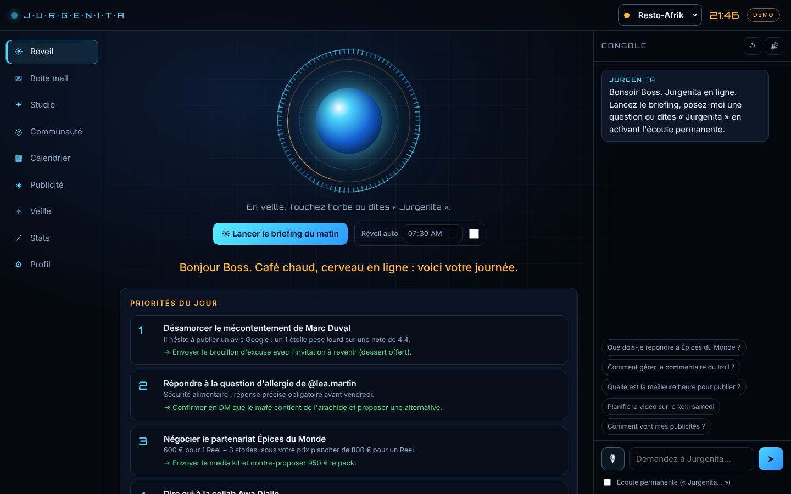

> **Essayez-la en 30 secondes, sans compte ni clé** : `npm install && npm start`, puis ouvrez http://127.0.0.1:3000.
> Le mode démo met en scène deux clients fictifs : **Resto-Afrik**, un restaurant africain, et **Maison Kora**, une marque de mode éthique.

---

## Objectif

Un créateur de contenu ou un community manager passe chaque jour des heures à trier des mails de marques, à répondre aux commentaires, à surveiller ses statistiques et à chercher des idées.
Jurgenita **automatise la préparation** de ce travail. **La décision et l'envoi restent humains** : elle trie, résume, rédige et propose, et vous validez.

| Pour qui | Ce que Jurgenita apporte |
|---|---|
| Créateurs de contenu, influenceurs | Négociation des partenariats selon vos tarifs, idées et scripts vidéo, analyse de vos visuels |
| Community managers et agences | Plusieurs clients dans un seul outil, validation des contenus par le client, publication programmée, rapport mensuel en PDF |
| Équipes publicité (media buyers) | Annonces A/B/C prêtes à lancer pour Meta, Google et TikTok, analyse des campagnes avec décision par annonce |
| Commerces locaux (restaurant, boutique) | Gestion des avis Google, idées pour remplir les jours creux, présence régulière sur les réseaux |

## Fonctionnalités

| Module | Ce qu'il fait |
|---|---|
| ☀ **Briefing du matin** | Lu à voix haute à l'heure du réveil : priorités, tri des mails, climat de la communauté, idées de contenu, conseil du jour. Aussi envoyé sur **Telegram**. |
| ✉ **Boîte mail** | Classe chaque mail (urgent, opportunité, à déléguer, à ignorer) et rédige la réponse selon votre intention. Le brouillon est créé **dans Gmail**, jamais envoyé automatiquement. |
| ✦ **Studio de contenu** | Un sujet donne un pack multi-plateformes : accroches, légendes, hashtags, horaires, CTA et script vidéo seconde par seconde. |
| 📷 **Analyse photo et vidéo** | Note l'accroche sur 10 et propose légende, recadrage (9:16, 4:5) et idée de montage. Pour une vidéo, quatre images sont extraites dans le navigateur. |
| 🏢 **Plusieurs marques** | Un client par marque : profil, ton, règles, accès et données séparés. On passe de l'une à l'autre en un clic. |
| ◎ **Communauté** | Commentaires, **messages privés** (Instagram, Messenger) et **avis Google** réunis. Jurgenita évalue le sentiment, la priorité et la modération, puis propose une réponse, publiée après confirmation. |
| ▦ **Calendrier et publication** | Circuit idée → brouillon → validation client → approuvé. Les contenus approuvés sont **publiés automatiquement** sur Instagram et Facebook à l'heure prévue. Pour les autres réseaux, vous êtes prévenu de publier à la main. |
| ✅ **Validation client** | Un lien secret par marque : le client valide ou demande une modification avec un commentaire, et vous êtes prévenu sur Telegram. |
| ◈ **Publicité** | Performances **Meta Ads** (dépense, CTR, CPC, conversions, ROAS) et décision par annonce : couper, augmenter, garder ou retravailler. **Générateur de campagnes** : audiences, variantes A/B/C pour Meta, Google (limites de 30 et 90 caractères contrôlées) et TikTok, brief créatif, plan de test et budget. |
| ⌖ **Veille** | Mentions de la marque, actualité des concurrents et tendances de la niche, cherchées sur le web, avec alerte en cas de risque de bad buzz. |
| 📄 **Rapport client** | Rapport de performance imprimable en PDF : audience, communauté, publicité, analyse et recommandations rédigées pour le client. |
| 🎙 **Console vocale** | Questions d'expertise (algorithmes, bad buzz, tarifs) avec un agent qui lit vos données, planifie, mémorise vos préférences et cherche les tendances sur le web. Se déclenche à la voix (« Jurgenita… »). |
| ⚙ **Personnalisation** | Ton de marque, objectifs et règles métier (marques refusées, prix planchers) que l'IA applique dans chaque décision. |

| Publicité | Calendrier et validation |
|---|---|
| 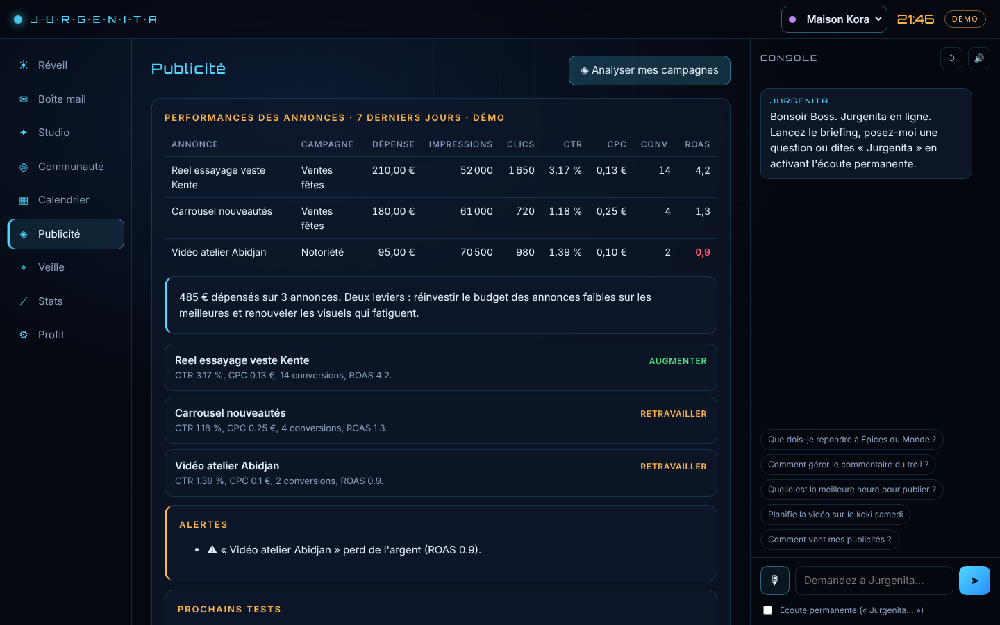 | 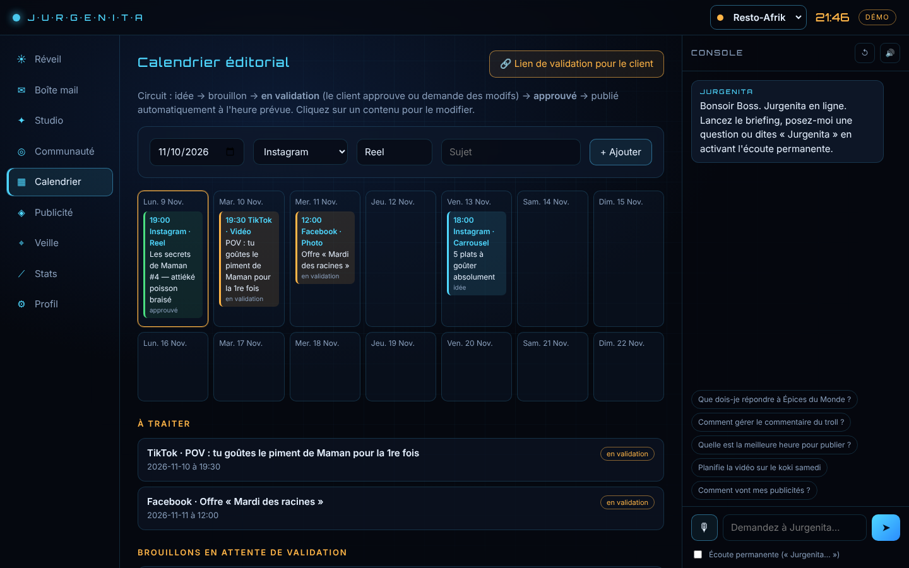 |
| **Boîte mail** | **Studio de contenu** |
| 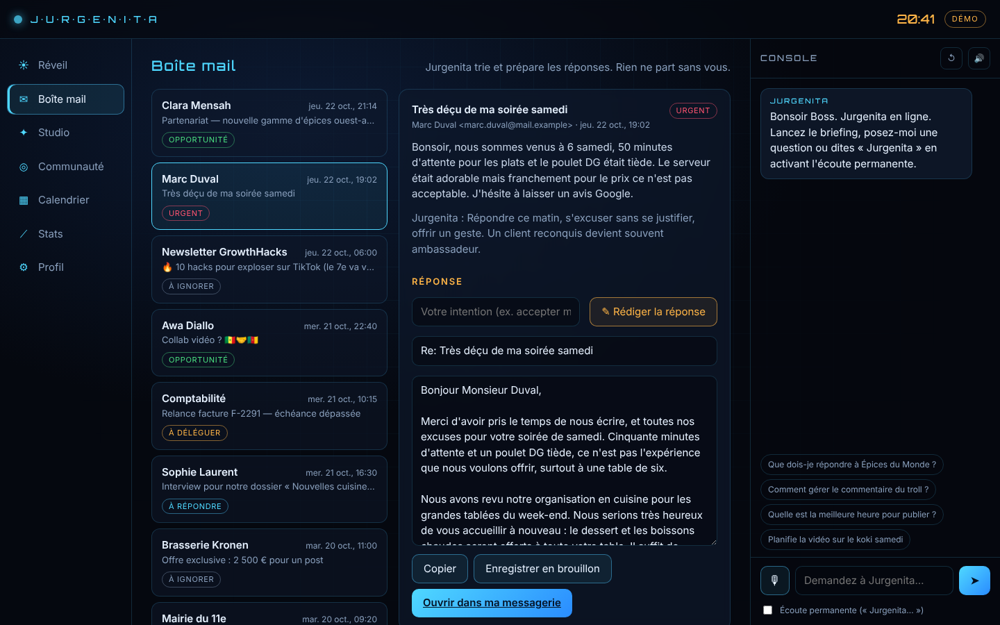 | 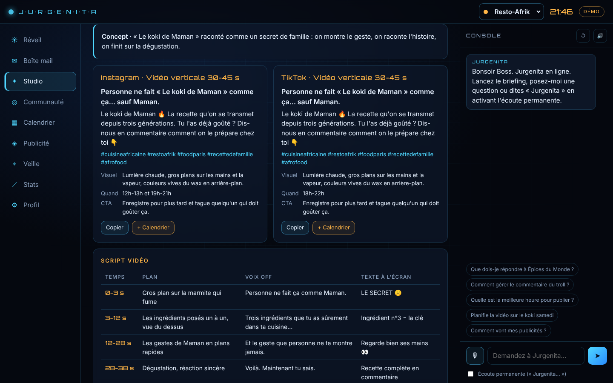 |
| **Communauté** | **Veille** |
| 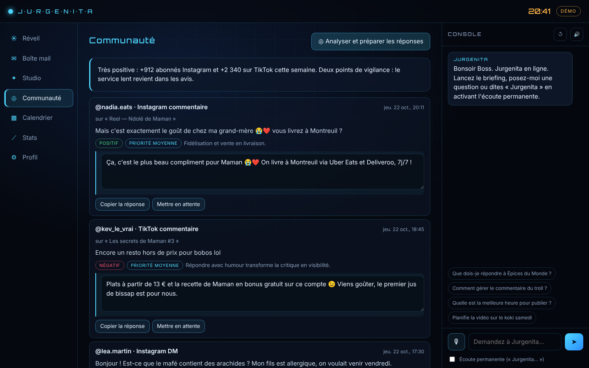 | 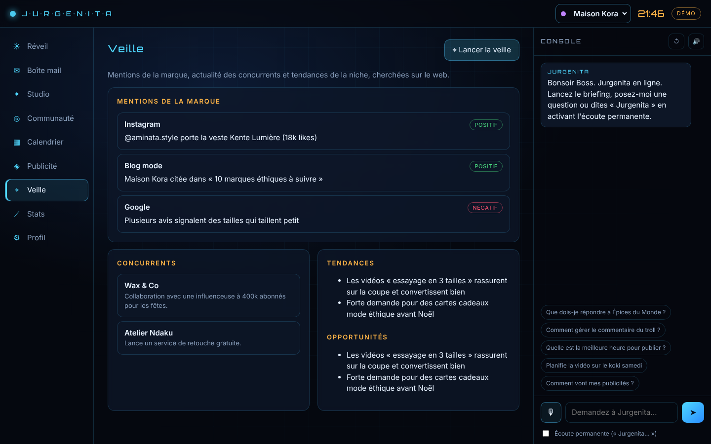 |

| Rapport client (PDF) | Validation par le client (mobile) | Version mobile |
|---|---|---|
| 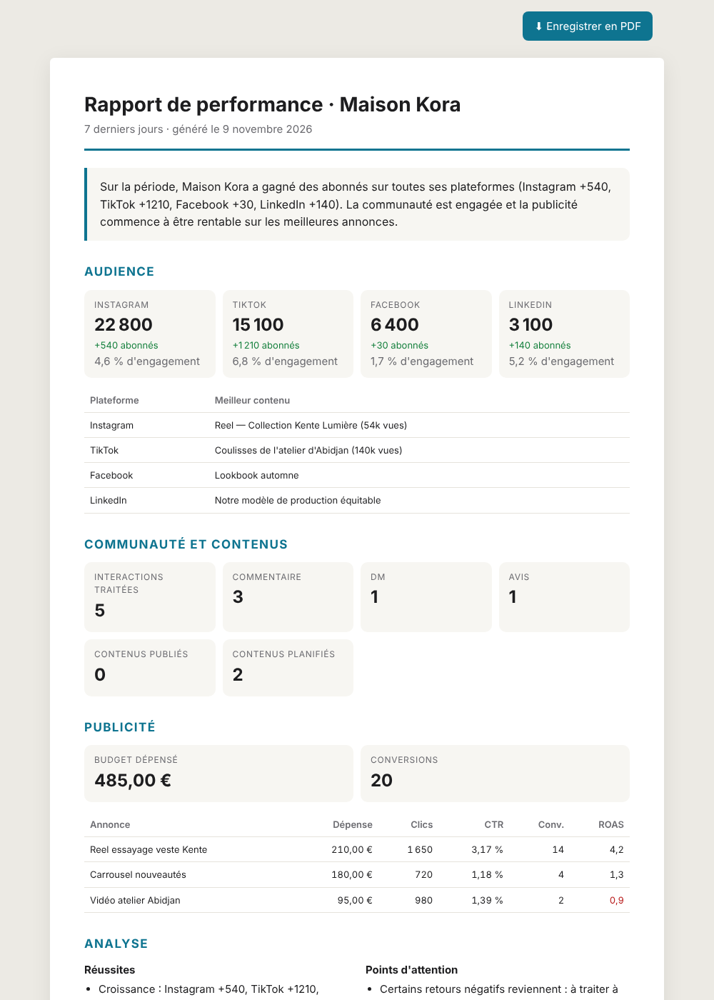 | 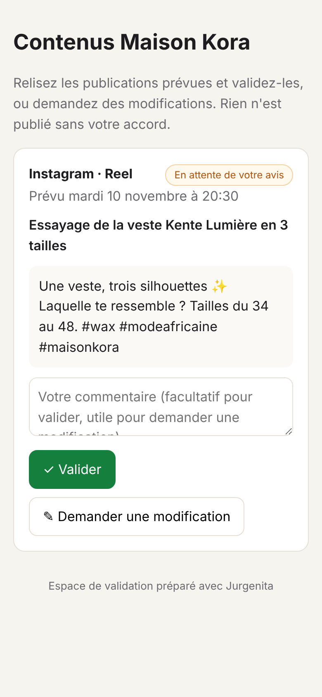 | 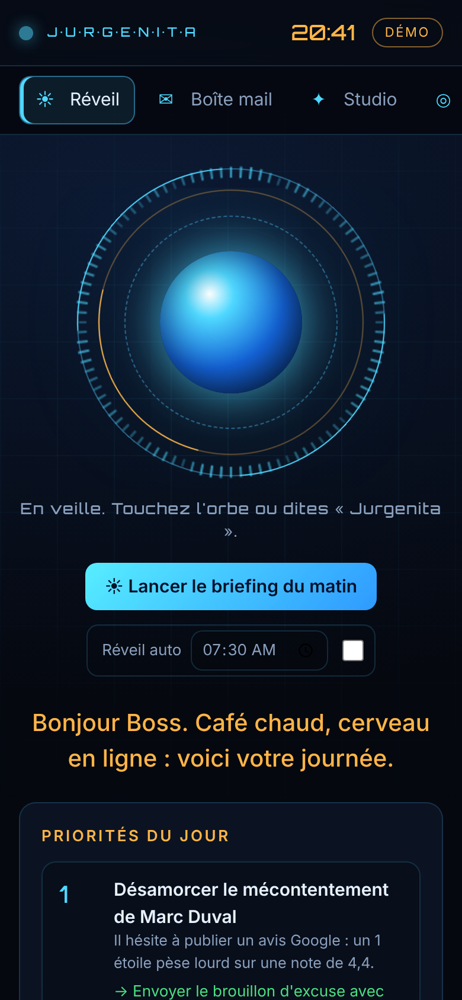 |

## Technologies

| Domaine | Choix |
|---|---|
| Serveur | **Node.js 20+**, module `http` natif, sans framework. Deux dépendances seulement : le SDK Anthropic et Zod. |
| Intelligence artificielle | **API Claude** (SDK `@anthropic-ai/sdk`) : sorties structurées validées par des schémas **Zod**, agent à outils (*tool runner*), recherche web, vision, cache de prompt, repli automatique côté serveur |
| Intégrations | **OAuth 2.0** Google (Gmail, Calendar, Business Profile), **Meta Graph API** (Instagram, Facebook, Messenger, Marketing API), **TikTok Display API**, **LinkedIn Community Management API**, **Telegram Bot API** |
| Interface | HTML, CSS et JavaScript sans framework. **Web Speech API** (reconnaissance et synthèse vocale en français), Canvas (orbe animé, extraction d'images vidéo), Web Audio |
| Automatisation | Publication programmée (vérification chaque minute), briefing quotidien sur Telegram, notifications de validation client |
| Qualité | 72 tests **`node:test`** (API de bout en bout, sécurité, robustesse, stockage des accès, journaux, connecteurs et publication avec réponses simulées), intégration continue **GitHub Actions** sur Node 20 et 22 |

## Architecture

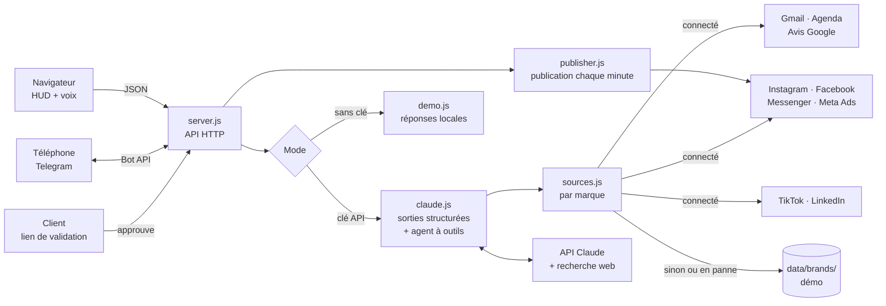

```
├── server.js              API HTTP, OAuth Google, validation client, Telegram, tâches planifiées
├── src/
│   ├── claude.js          appels à Claude : briefing, studio, vision, publicité, veille, rapport, agent
│   ├── demo.js            même interface, sans IA (mode démo)
│   ├── brands.js          marques (clients) et leurs accès, gardés hors de Git
│   ├── sources.js         données par marque : vrais comptes si connectés, sinon démo
│   ├── publisher.js       circuit de validation et publication programmée
│   ├── connectors/        google · meta · tiktok · linkedin · telegram
│   ├── schemas.js         formats JSON garantis (Zod)
│   ├── prompts.js         personnalité de Jurgenita
│   └── store.js           stockage JSON local
├── public/                interface (HUD, voix, orbe), page de validation client, rapport PDF
├── data/                  vos données (boîte mail, agenda) et brands/<marque>/ (démo fictive)
├── test/                  tests de l'API et des connecteurs
└── .github/workflows/     intégration continue
```

## Sécurité et choix de conception

- **L'humain valide toujours** : aucun mail n'est envoyé, une réponse publique n'est publiée qu'après une confirmation explicite, et un contenu ne part que s'il est **approuvé** (par vous ou par le client).
- **Lien de validation client** : jeton aléatoire de 144 bits propre à chaque marque. Le client ne voit que les contenus à valider de sa marque, et ne peut que les approuver ou demander une modification.
- **Accès séparés par marque** : les jetons de chaque client sont gardés dans `data/secrets/brands/` (permissions `600`) et ne sont jamais renvoyés à l'interface.
- **Accès local uniquement** : le serveur écoute sur `127.0.0.1`, car il n'a pas d'authentification.
- **Secrets hors du code** : les clés sont dans `.env`, le jeton Google dans `data/secrets/` (permissions `600`), et les deux sont exclus de Git.
- **Protection contre les requêtes venues d'autres sites** (`src/security.js`) : seuls les noms de site autorisés sont servis (contre le DNS rebinding), les actions doivent venir de Jurgenita elle-même et être envoyées en JSON (contre le CSRF), et Jurgenita refuse de s'afficher dans le cadre d'un autre site (contre le clickjacking). Vérifié par des tests qui rejouent chaque attaque sur chaque action sensible.
- **Connexion Google protégée contre la falsification de requête (CSRF)** : un paramètre `state` aléatoire est vérifié au retour de Google.
- **Telegram verrouillé** : le bot ne répond qu'au chat de son propriétaire.
- **Interface protégée contre l'injection de code (XSS)** : le contenu externe (mails, commentaires) est inséré comme texte, jamais comme HTML.
- **Journaux sans secrets** (`src/redact.js`) : tout ce que le serveur écrit est filtré (jetons Meta, Google, Telegram, Anthropic, paramètres d'URL sensibles, valeurs exactes des accès configurés). Une erreur inattendue ne renvoie au navigateur qu'un message générique avec une référence, le détail restant dans le journal.
- **Accès des marques jamais perdus** (`src/atomic-file.js`) : écritures atomiques et vérifiées (fichier temporaire, vidage sur disque, relecture, remplacement en une opération), sûres même en cas de coupure de courant ou d'arrêt forcé. Un fichier d'accès abîmé est signalé (diagnostic sans aucun extrait de son contenu) et n'est jamais écrasé.
- **Requêtes bornées** : JSON mal formé refusé (400), 1 Mo maximum par requête (20 Mo pour l'analyse d'images).
- **Connexions Google** : paramètre `state` aléatoire de 256 bits, à usage unique, valable 10 minutes, 50 connexions en attente au maximum.
- **Robustesse** : une source en panne retombe sur les données de démo au lieu de bloquer le briefing. Les sorties de l'IA sont validées par schéma, avec une valeur de repli quand Claude répond hors d'une liste attendue.

## Installation

```bash
git clone https://github.com/sikati7/jurgenita.git
cd jurgenita
npm install
npm start          # http://127.0.0.1:3000, à ouvrir dans Chrome ou Edge pour la voix
```

> Sous Windows, si PowerShell bloque `npm`, utilisez `npm.cmd install` et `npm.cmd start`.

Pour passer en mode réel, copiez `.env.example` en `.env`, puis suivez le guide **[CONNEXIONS.md](CONNEXIONS.md)** : clé API Claude, Gmail, Instagram et Facebook, Telegram.

```bash
npm test           # 72 tests : API en mode démo, sécurité, robustesse, stockage des accès, journaux, connecteurs et publication avec réponses simulées
npm run check      # vérification de la syntaxe
```

## État d'avancement

**Prototype fonctionnel**, utilisable au quotidien en local.

| Élément | État |
|---|---|
| Interface vocale, briefing, boîte mail, studio, analyse visuelle, communauté, statistiques | ✅ Terminé |
| Plusieurs marques (clients), accès séparés par marque | ✅ Terminé |
| Circuit de validation, lien de validation client, publication programmée Instagram et Facebook | ✅ Terminé (testé avec des réponses simulées) |
| Publicité : générateur de campagnes, analyse Meta Ads | ✅ Terminé (testé avec des réponses simulées) |
| Veille web, rapport client en PDF | ✅ Terminé |
| Messages privés Instagram et Messenger, avis Google | ✅ Terminé (testé avec des réponses simulées ; avis Google soumis à l'accord de Google) |
| Statistiques TikTok et LinkedIn | ✅ Terminé (testé avec des réponses simulées ; jeton TikTok à renouveler chaque jour) |
| Mode démo complet, sans compte | ✅ Terminé |
| Tests automatisés et intégration continue | ✅ En place |
| Essai avec de vrais comptes | 🟡 En cours |
| Hébergement en ligne 24 h/24 (comptes utilisateurs, HTTPS), nécessaire au lien de validation client | ⏳ À faire |
| Publication automatique des vidéos (Reels, TikTok) | ⏳ À faire |
| Lecture des performances Google Ads et TikTok Ads | ⏳ À faire |
| Équipe : plusieurs utilisateurs avec des droits différents | ⏳ À faire |

## Feuille de route

1. **Déploiement cloud** : conteneur Docker, comptes utilisateurs, HTTPS, pour un lien de validation accessible au client et un briefing envoyé même ordinateur éteint.
2. **Publication des vidéos** (Reels, TikTok) et des carrousels.
3. **Performances Google Ads et TikTok Ads**, en plus de Meta Ads.
4. **Travail en équipe** : plusieurs utilisateurs, rôles, historique des validations.
5. **Renouvellement automatique** des jetons TikTok et LinkedIn.

---

Projet conçu et développé par [sikati7](https://github.com/sikati7), avec l'aide de Claude Code. Les données de démonstration (personnes, marques, adresses) sont fictives.
