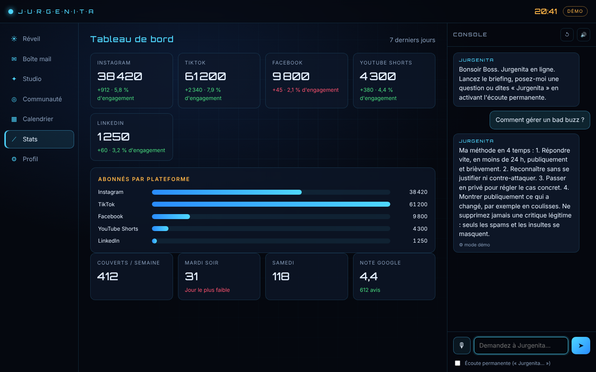
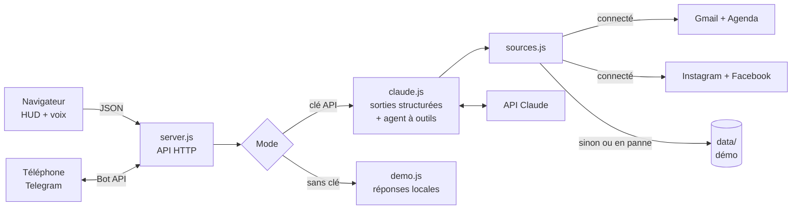

# ◉ J·U·R·G·E·N·I·T·A

[](https://github.com/sikati7/jurgenita/actions/workflows/ci.yml)


**Jurgenita est une assistante IA vocale, dans l'esprit de J.A.R.V.I.S., pour les créateurs de contenu et les community managers.**
Chaque matin, elle lit vos mails, votre agenda et vos réseaux sociaux. Elle vous dit à voix haute ce qui compte, prépare les réponses et vous propose quoi publier. Elle répond aussi à vos questions de marketing digital.


> **Essayez-la en 30 secondes, sans compte ni clé** : `npm install && npm start`, puis ouvrez http://127.0.0.1:3000.
> Le mode démo met en scène **Resto-Afrik**, un restaurant africain fictif qui publie sur les réseaux.

---

## Objectif

Un créateur de contenu ou un community manager passe chaque jour des heures à trier des mails de marques, à répondre aux commentaires, à surveiller ses statistiques et à chercher des idées.
Jurgenita **automatise la préparation** de ce travail. **La décision et l'envoi restent humains** : elle trie, résume, rédige et propose, et vous validez.

| Pour qui | Ce que Jurgenita apporte |
|---|---|
| Créateurs de contenu, influenceurs | Négociation des partenariats selon vos tarifs, idées et scripts vidéo, analyse de vos visuels |
| Community managers | Tri des commentaires et avis, réponses dans le ton de la marque, alertes de crise |
| Commerces locaux (restaurant, boutique) | Gestion des avis Google, idées pour remplir les jours creux, présence régulière sur les réseaux |

## Fonctionnalités

| Module | Ce qu'il fait |
|---|---|
| ☀ **Briefing du matin** | Lu à voix haute à l'heure du réveil : priorités, tri des mails, climat de la communauté, idées de contenu, conseil du jour. Aussi envoyé sur **Telegram**. |
| ✉ **Boîte mail** | Classe chaque mail (urgent, opportunité, à déléguer, à ignorer) et rédige la réponse selon votre intention. Le brouillon est créé **dans Gmail**, jamais envoyé automatiquement. |
| ✦ **Studio de contenu** | Un sujet donne un pack multi-plateformes : accroches, légendes, hashtags, horaires, CTA et script vidéo seconde par seconde. |
| 📷 **Analyse photo et vidéo** | Note l'accroche sur 10 et propose légende, recadrage (9:16, 4:5) et idée de montage. Pour une vidéo, quatre images sont extraites dans le navigateur. |
| ◎ **Communauté** | Évalue le sentiment de chaque commentaire, sa priorité et la modération à appliquer, puis propose une réponse. Celle-ci est publiée sur Instagram ou Facebook après confirmation. |
| ▦ **Calendrier éditorial** | Planning sur 14 jours, alimenté par le Studio et par la conversation. |
| 🎙 **Console vocale** | Questions d'expertise (algorithmes, bad buzz, tarifs) avec un agent qui lit vos données, planifie, mémorise vos préférences et cherche les tendances sur le web. Se déclenche à la voix (« Jurgenita… »). |
| ⚙ **Personnalisation** | Ton de marque, objectifs et règles métier (marques refusées, prix planchers) que l'IA applique dans chaque décision. |

| Boîte mail | Studio de contenu |
|---|---|
|  |  |
| **Communauté** | **Statistiques et console** |
|  |  |

<p align="center"></p>

## Technologies

| Domaine | Choix |
|---|---|
| Serveur | **Node.js 20+**, module `http` natif, sans framework. Deux dépendances seulement : le SDK Anthropic et Zod. |
| Intelligence artificielle | **API Claude** (SDK `@anthropic-ai/sdk`) : sorties structurées validées par des schémas **Zod**, agent à outils (*tool runner*), recherche web, vision, cache de prompt, repli automatique côté serveur |
| Intégrations | **OAuth 2.0** Google (Gmail API, Calendar API), **Meta Graph API** (Instagram, Facebook), **Telegram Bot API** |
| Interface | HTML, CSS et JavaScript sans framework. **Web Speech API** (reconnaissance et synthèse vocale en français), Canvas (orbe animé, extraction d'images vidéo), Web Audio |
| Qualité | Tests **`node:test`** (API de bout en bout, connecteurs avec réponses simulées), intégration continue **GitHub Actions** sur Node 20 et 22 |

## Architecture



```
├── server.js              API HTTP, OAuth Google, Telegram, briefing planifié
├── src/
│   ├── claude.js          appels à Claude : briefing, réponses, studio, vision, agent
│   ├── demo.js            même interface, sans IA (mode démo)
│   ├── sources.js         vrais comptes si connectés, sinon démo ; repli en cas de panne
│   ├── connectors/        google.js · meta.js · telegram.js
│   ├── schemas.js         formats JSON garantis (Zod)
│   ├── prompts.js         personnalité de Jurgenita
│   └── store.js           stockage JSON local
├── public/                interface (HUD, voix, orbe)
├── data/                  données de démo fictives
├── test/                  tests de l'API et des connecteurs
└── .github/workflows/     intégration continue
```

## Sécurité et choix de conception

- **L'humain valide toujours** : aucun mail n'est envoyé, et une réponse publique n'est publiée qu'après une confirmation explicite.
- **Accès local uniquement** : le serveur écoute sur `127.0.0.1`, car il n'a pas d'authentification.
- **Secrets hors du code** : les clés sont dans `.env`, le jeton Google dans `data/secrets/` (permissions `600`), et les deux sont exclus de Git.
- **OAuth protégé contre la falsification de requête (CSRF)** : un paramètre `state` aléatoire est vérifié au retour de Google.
- **Telegram verrouillé** : le bot ne répond qu'au chat de son propriétaire.
- **Interface protégée contre l'injection de code (XSS)** : le contenu externe (mails, commentaires) est inséré comme texte, jamais comme HTML.
- **Robustesse** : une source en panne retombe sur les données de démo au lieu de bloquer le briefing. Les sorties de l'IA sont validées par schéma.

## Installation

```bash
git clone https://github.com/sikati7/jurgenita.git
cd jurgenita
npm install
npm start          # http://127.0.0.1:3000, à ouvrir dans Chrome ou Edge pour la voix
```

> Sous Windows, si PowerShell bloque `npm`, utilisez `npm.cmd install` et `npm.cmd start`.

Pour passer en mode réel, copiez `.env.example` en `.env`, puis suivez le guide **[CONNEXIONS.md](CONNEXIONS.md)** : clé API Claude, Gmail, Instagram et Facebook, Telegram.

```bash
npm test           # 16 tests : API en mode démo et connecteurs avec réponses simulées
npm run check      # vérification de la syntaxe
```

## État d'avancement

**Prototype fonctionnel**, utilisable au quotidien en local.

| Élément | État |
|---|---|
| Interface vocale, briefing, boîte mail, studio, communauté, calendrier, statistiques | ✅ Terminé |
| Mode démo complet, sans compte | ✅ Terminé |
| Cerveau Claude : sorties structurées, agent à outils, recherche web, vision | ✅ Terminé (testé contre une API simulée) |
| Gmail et Google Agenda : lecture et brouillons | ✅ Terminé (testé avec des réponses simulées) |
| Instagram et Facebook : commentaires, statistiques, réponses | ✅ Terminé (testé avec des réponses simulées) |
| Telegram : briefing quotidien et discussion | ✅ Terminé (testé avec des réponses simulées) |
| Tests automatisés et intégration continue | ✅ En place |
| Essai avec de vrais comptes | 🟡 En cours |
| Hébergement en ligne 24 h/24 (Docker, authentification) | ⏳ À faire |
| Lecture des messages privés Instagram et Facebook (validation Meta) | ⏳ À faire |
| TikTok et YouTube | ⏳ À faire |

## Feuille de route

1. **Déploiement cloud** : conteneur Docker, authentification, HTTPS, pour un briefing envoyé même ordinateur éteint.
2. **Messages privés** Instagram et Facebook.
3. **Statistiques TikTok et YouTube**, et rapport hebdomadaire.
4. **Voix neuronale** propre à Jurgenita.
5. **Veille concurrentielle** automatique sur les comptes et hashtags de la niche.

---

Projet conçu et développé par [sikati7](https://github.com/sikati7), avec l'aide de Claude Code. Les données de démonstration (personnes, marques, adresses) sont fictives.
